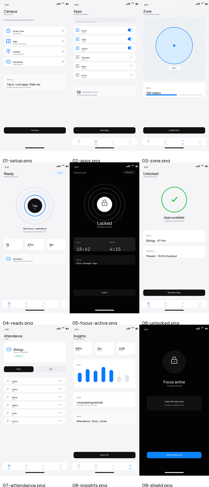
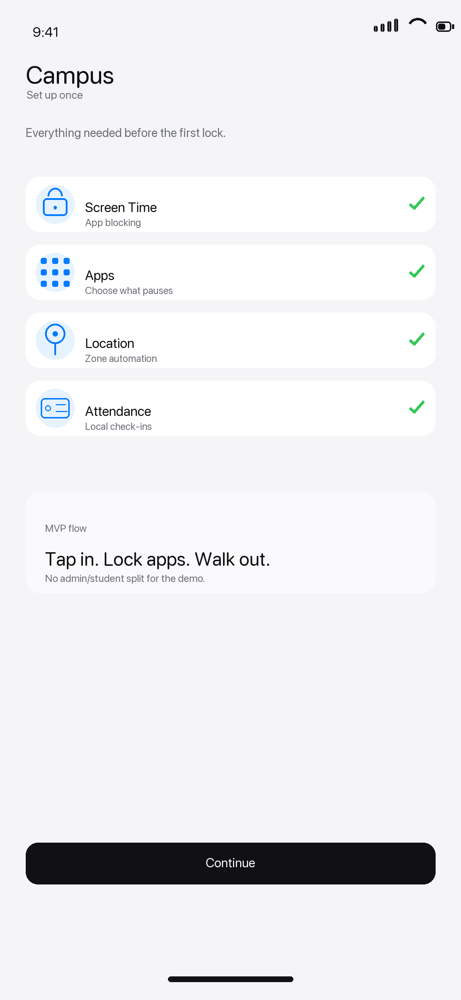
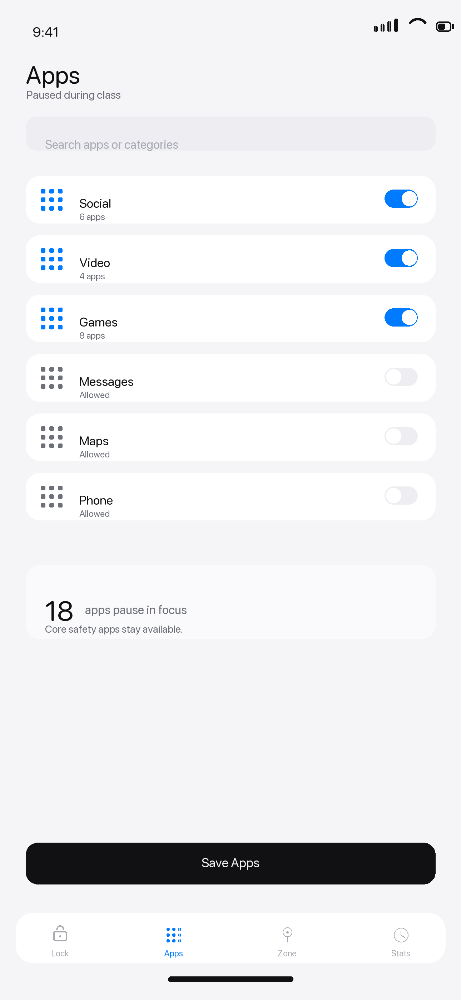
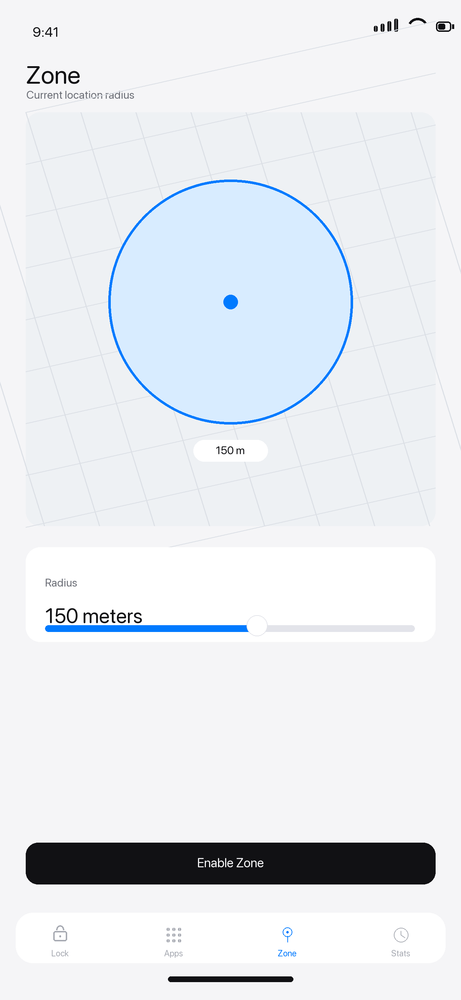
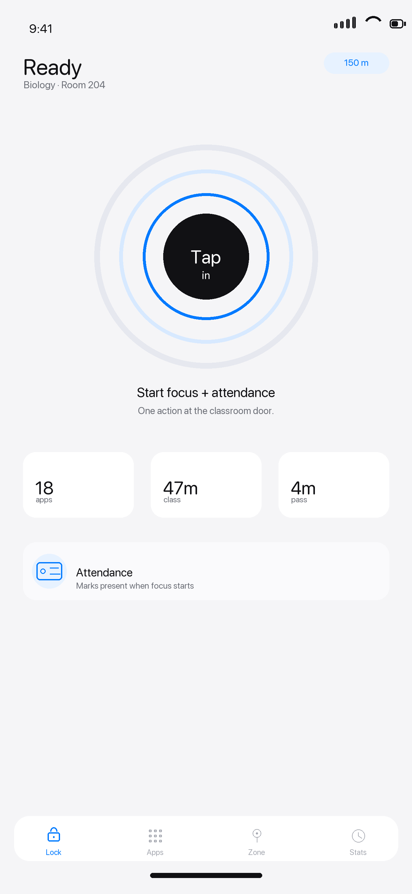
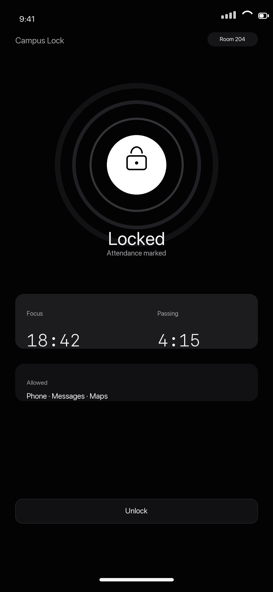
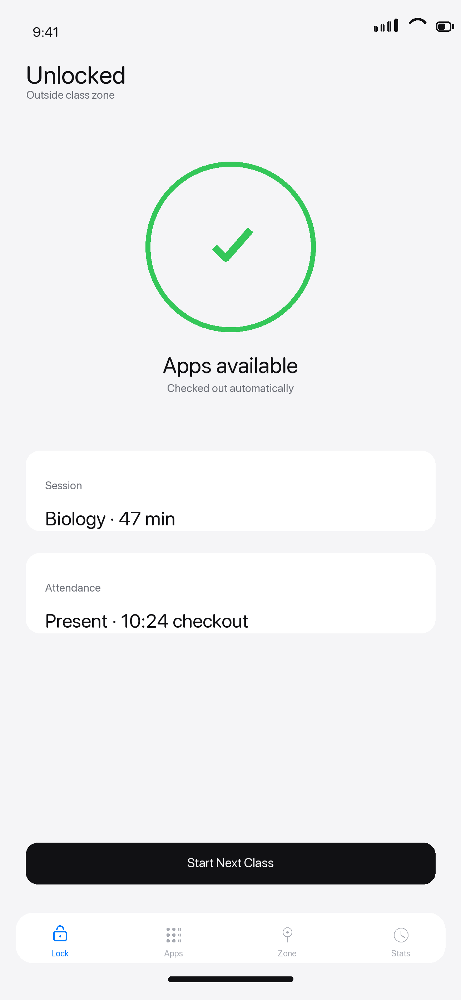
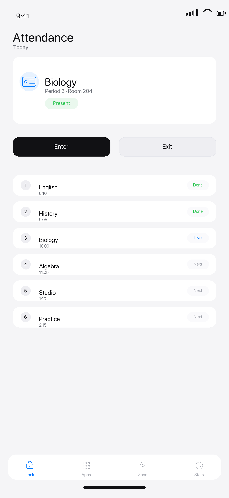
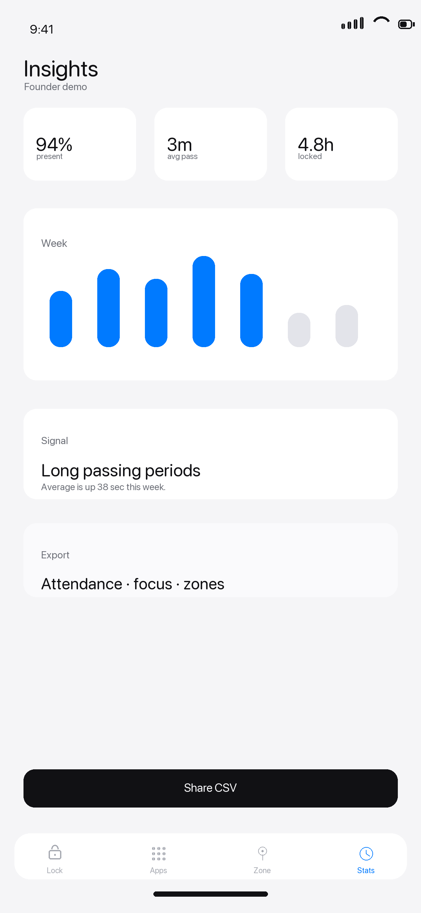
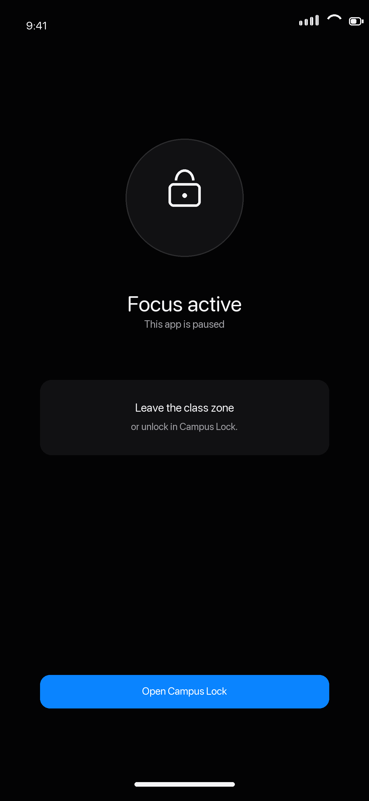

# Final Screen Mockups

Production-ready native iPhone mockups for the Campus Lock MVP.

Design direction:

- Flat SwiftUI surfaces instead of 3D marketing art.
- System typography, large tap targets, grouped cards, native tab bar patterns.
- One accent color, restrained status colors, no decorative gradients.
- Minimal text: every screen should be understandable through state, icon, and action.

Screens:

0. 
1. 
2. 
3. 
4. 
5. 
6. 
7. 
8. 
9. 

Regenerate:

```sh
python3 design/generate_final_mockups.py
```
