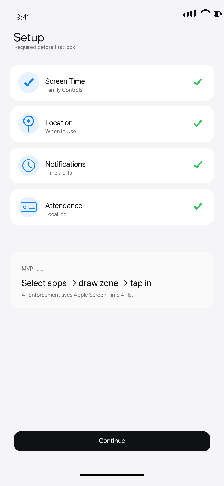
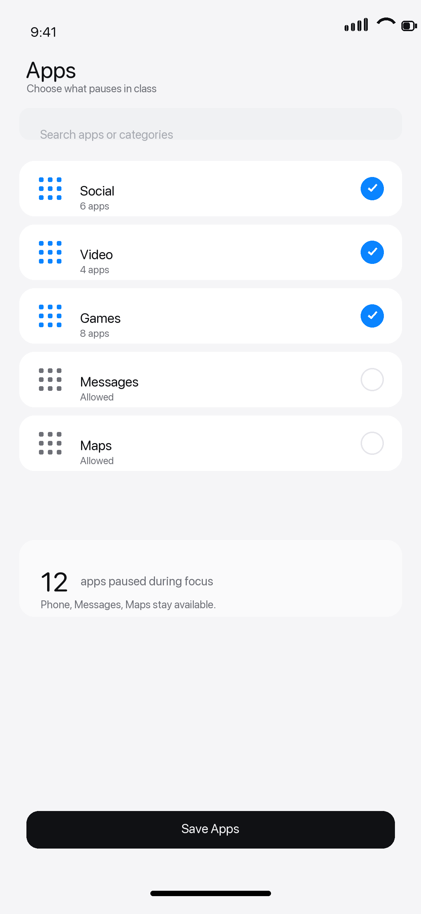
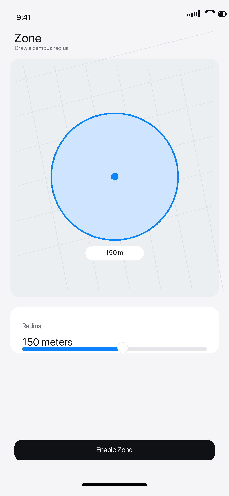
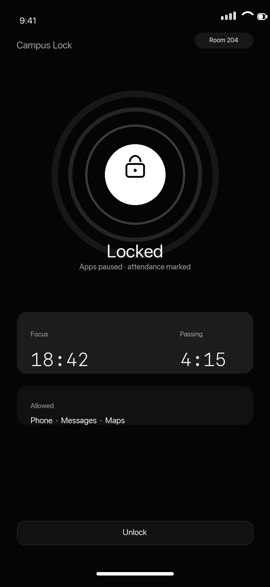
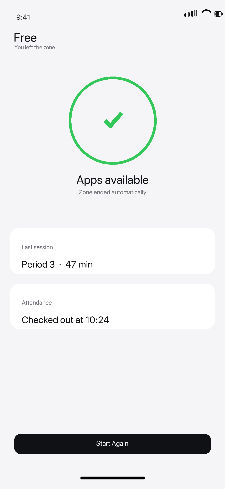
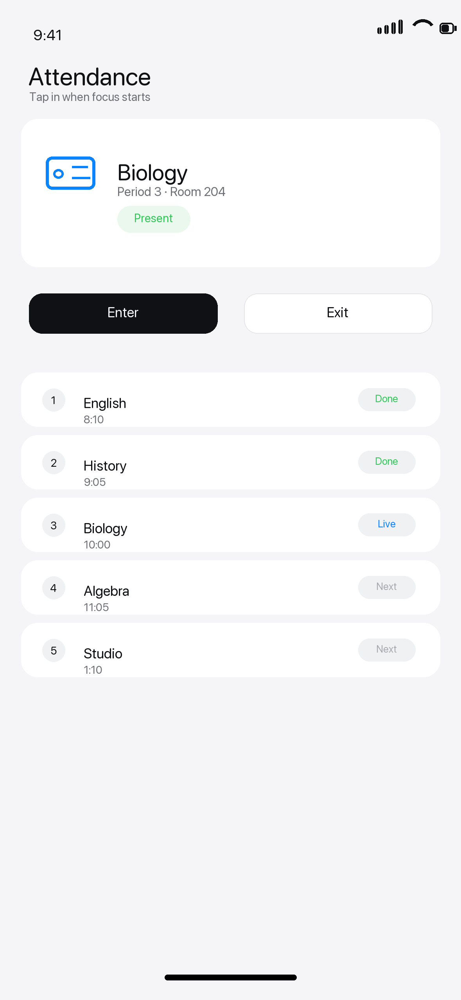
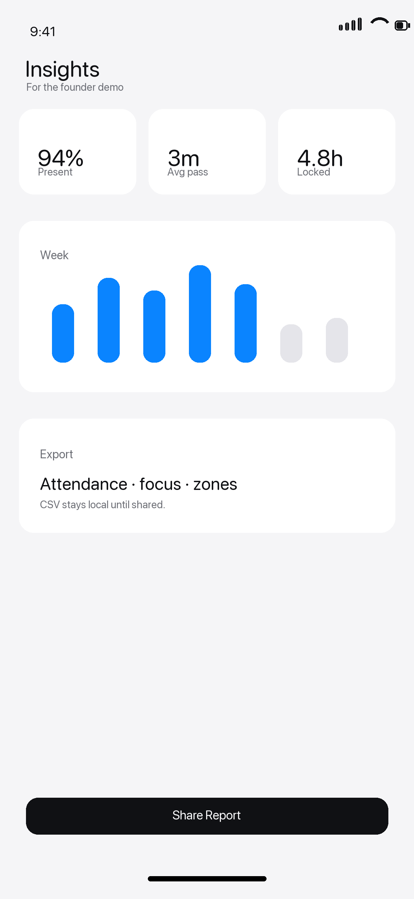
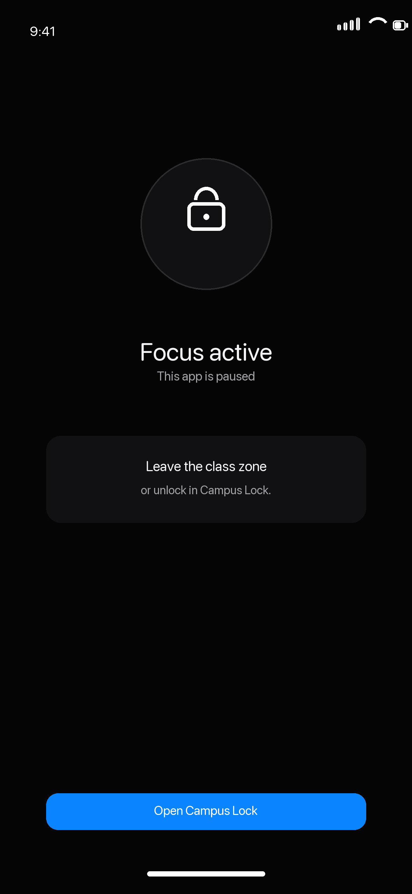

# Native SwiftUI Direction

These are flat, production-direction mockups for the Campus Lock MVP.

Design constraints:

- Native SwiftUI surfaces first: grouped lists, cards, sliders, sheets, shields.
- No 3D device renders, floating hardware, neon depth, or marketing compositions.
- Minimal words: short labels, system-style controls, icon-first rows.
- Mostly monochrome with one system-blue accent and system-green success states.
- Dark mode only where the real product benefits from it: active lock and shield.

Screens:

1. 
2. 
3. 
4. 
5. 
6. 
7. 
8. 

Regenerate:

```sh
python3 design/generate_native_mockups.py
```
